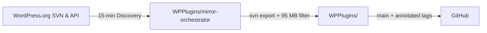

# WPPlugins

[](https://github.com/WPPlugins/mirror-orchestrator/actions/workflows/mirror.yml)
[](https://github.com/orgs/WPPlugins/repositories)
[](https://deno.com/)
[](https://github.com/WPPlugins/mirror-orchestrator/blob/main/LICENSE)

**WPPlugins** is an automated, serverless **WordPress.org SVN-to-GitHub** mirror for WordPress plugins. Every mirrored plugin lives in its own repository at:

```text
https://github.com/WPPlugins/<plugin-slug>
```

---

## Finding & Using a Plugin Mirror

- **Browse or search:** Visit the [WPPlugins repositories list](https://github.com/orgs/WPPlugins/repositories) or navigate directly to `https://github.com/WPPlugins/<plugin-slug>` (for example, [`WPPlugins/akismet`](https://github.com/WPPlugins/akismet)).
- **Branches & Tags:**
  - `main` tracks the plugin's WordPress.org SVN `trunk/`. *(Older pre-orchestrator mirrors may also have a `master` branch.)*
  - Annotated Git tags match WordPress.org SVN `tags/*` in SemVer order.
- **Metadata:** Each repository includes the plugin's WordPress.org description, homepage link (`https://wordpress.org/plugins/<slug>/`), and the `wordpress-plugin` topic.

---

## How It Works

All mirroring runs centrally in [**`WPPlugins/mirror-orchestrator`**](https://github.com/WPPlugins/mirror-orchestrator) on **GitHub Actions** with zero external server infrastructure:



1. **Discovery:** Polls WordPress.org updates and new plugin feeds every 15 minutes, plus a gradual backfill queue for older plugins.
2. **Incremental Export:** Exports missing SVN `tags/*` and `trunk/` into Git commits with SVN revision and author metadata.
3. **GitHub Safety:** Strips individual files larger than `95 MB` (logged in [`state/oversized.json`](https://github.com/WPPlugins/mirror-orchestrator/blob/main/state/oversized.json)) so GitHub's `100 MB` blob limit never blocks a sync.

---

## Important Notes

- **Read-Only Mirrors:** Do not open plugin bug reports or pull requests on mirrored repositories—please submit those directly to the plugin authors on [WordPress.org](https://wordpress.org/plugins/).
- **Request a Plugin or Report a Sync Issue:** Use the issue forms in [`WPPlugins/mirror-orchestrator`](https://github.com/WPPlugins/mirror-orchestrator/issues/new/choose).
